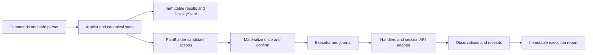

# Current application and execution architecture

All commands in the initial migration, including form rename, use one confirmed-plan
executor. The [stage records](execution-refactor-plan.md) and
[rename implementation record](execution-refactor-rename.md) explain the checkpoints,
the user-confirmed shared-label contract and intentional behavior changes.

## Module responsibilities

| Module | Responsibility |
| --- | --- |
| `command_list.py`, `command_card.py`, `page.py` | Authoring, selection, confirmation, recovery choice and rendering. The page reads immutable command results and report display snapshots. |
| `applier.py` | Headless command application, frozen iteration targets, variables, atomic draft publication and generation/cancellation guards. No endpoint writes. |
| `resource_state.py`, `multi_form.py` | Canonical resource payloads/revisions and successful baseline evidence; form selection by ResourceKey. No visit-based write schedule. |
| `application_results.py` | Authored/actual results, immutable historical context and detached display projections. |
| `planning.py` | Typed effects, groups, candidate actions, footprints, creator provenance and isolated persisted deletions. |
| `confirmed_plan.py` | Stable identity allocation and exact frozen request review; evaluation/source/session binding and single-use execution attempts. |
| `executor.py` | All-baseline preflight, immediate checks, no-op skips, attempt-before-write journal, outcome classification and verified reverse recovery. |
| `action_handlers.py` | Schema/deletion and owned-resource-property comparisons, request intents, compensation intents and capability gates. |
| `api.py`, `endpoint_evidence.py` | Generated endpoint encoding/decoding, structured reads/failures, immutable receipts and versions. |
| `schema_change.py` | Schema equivalence only; the old execution functions are removed. |
| `schema_identity.py`, `schema_names.py`, `schema_resolution.py` | Identity/formula protection, names/defaults, reference labels and cached Apply reads. |

## Invariants and supported behavior

Apply publishes state, variables, identities, effects and planning together after
successful transformation and required resolution. Failure retains preceding
published state; rejected candidates are separate diagnostic attachments.
Historical display context is pinned; inspecting a tab changes no application state.
DisplayState.form_payloads() returns detached form-schema dictionaries;
tab_payloads() includes database-resource tabs, and tab_metadata() supplies their
pinned names and annotations. Mutating returned payloads cannot change the snapshot.
DisplayState.tabs() provides typed DisplayTab values with labels separate from JSON
payloads. Form tabs show schema objects; database-resource tabs use the pinned
database name (falling back to its ID) and show the resource array directly.
Database resources bypass form name/formula processing in previews and execution
reports.
Both resource types use schema_names.readable_resource() for Names mode. Form
schemas retain their existing substitution rules; database-resource parentId
references use labels from that resource array, or the pinned database name for
the root. Unknown names retain IDs. Both use the same substitution spans and
underlining, without changing canonical payloads or IDs mode.

Apply is command-first across forms. Compatible schema effects may accumulate as
form-first writes. This accepted batching limitation does not imply arbitrary
cross-form read/write consistency. Explicit prerequisites, endpoint/scope boundaries
and deletion boundaries constrain grouping; there is no general dependency graph.
Resource moves precede later schema edits and may batch compatible entries.
MoveForm requires currentForm: true uses the current application form and retains
the existing form scope and variables; false selects form/formPattern and establishes
a scope as before. The creator declares this required boolean first and conditionally
shows the form selector using ParameterDefinition.visible_when.

Rename is one schema action with a ResourceProjection for the same label's
database-tree representation. The projection changes canonical/display state and
declares verification footprints; it is not another endpoint write. Shared-label
actions seal adjacent groups so later schema edits/moves retain coherent predecessors.
Explicit predecessor provenance includes the action that projected a resource.

Identity materialization precedes confirmation and is retained for that attempt.
Formula literals and historical preview identities are preserved. Execution cannot
substitute variables, expand commands, allocate replacement identities or query
names/defaults. Reference-default cache keys use immutable scalar type tags so
resolved aliases survive confirmation with numeric/string distinctions intact.

Every required baseline is checked before any write; each action then checks its
immediate predecessor and explicit member prerequisites. The executor journals
before sending. It reads back on reported success and error, distinguishing
intended, unchanged, divergent and unknown state. Receipts alone prove none of these.
A reported error stops forward execution even when intended state is observed.

Observations can retain related observations, including each receipt/version or
structured read failure. Rename preflight and immediate checks cover the schema
plus the resource label, existence and type. Post-write classification and recovery
check both representations. A missing read makes the outcome unknown; inconsistent
observed labels are divergent. One schema restoration compensates the shared label,
with both representations verified and unrelated resource properties preserved.

RollbackLast skips proven unchanged attempts. RollbackAll reverses applicable
actions. Unknown outcomes reconcile first; divergent outcomes do not establish
ownership, even if a later read matches the divergent state. Concurrent changes,
unknown preconditions or failed/unverified compensation stop recovery. Reported
recovery errors also stop, retaining read-back evidence. Forward and recovery
histories are separate immutable values; reports never fill unknown state with an
intended payload. Caches can be cleared without altering retained plans or reports.

Schema replacement compares the schema using its established defaults/equivalence.
Resource patches compare owned properties with strict presence/type semantics and
required existence/type, preserving unrelated concurrent properties. Missing form/
folder parents normalize specifically to the documented database-root identity.
Read-check-write still has a concurrency window; it is not a conditional write or
cross-endpoint transaction.

## Capability limits

| Capability | Status |
| --- | --- |
| Add/modify/move/delete fields, WithForm, SetVariable | Supported through Apply and confirmed execution where writes are required. |
| ModifyForm record label, including clear and pending field IDs | Supported. |
| MoveForm within its database, top-level forms | Supported with resource snapshots and owned-property compensation. |
| ModifyForm name | Supported for forms/subforms using one schema write and verification/recovery of both representations of the shared label. |
| Persisted-field compensation | Schema-only; record-data restoration unverified. |
| Arbitrary resource property clearing, AddForm/DeleteForm, new recovery endpoints | Not enabled; separate feature/evidence work. |

No live recovery experiment or dependency upgrade was part of stages 0–7.

## Regression fixture construction

`test/execution_fixtures.py` translates low-level dict-service scenarios into typed
candidate plans, local pre-confirmation preparation and a mock observation/write
adapter. It delegates all execution/recovery to the production Executor; it contains
no competing journal, retry or compensation loop. Older fixture assertions now use
the actual report statuses, immediate-read behavior and conservative recovery rules.
`test/form_command_runtime.py` similarly adapts the preserved form-command mocks.
UI workflow tests use the real Applier, confirmation gate and Executor with mocked
services. These test construction helpers are not imported by application modules.
