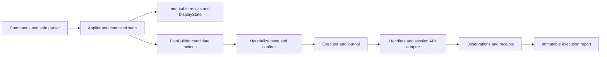

# Current application and execution architecture

All commands in the initial migration, including form rename, use one confirmed-plan
executor. The [stage records](execution-refactor-plan.md) and
[rename implementation record](execution-refactor-rename.md) explain the checkpoints,
the user-confirmed shared-label contract and intentional behavior changes.

## Module responsibilities

| Module | Responsibility |
| --- | --- |
| `command_list.py`, `command_card.py`, `page.py` | Authoring, selection, confirmation, recovery choice and rendering. The page reads immutable command results and report display snapshots. |
| `applier.py` | Headless command application, frozen iteration targets, variables, atomic draft publication and generation/cancellation guards. No endpoint writes. |
| `resource_state.py`, `multi_form.py` | Canonical resource payloads/revisions and successful baseline evidence; form selection by ResourceKey. No visit-based write schedule. |
| `application_results.py` | Authored/actual results, immutable historical context and detached display projections. |
| `planning.py` | Typed effects, groups, candidate actions, footprints, creator provenance and isolated persisted deletions. |
| `confirmed_plan.py` | Stable identity allocation and exact frozen request review; evaluation/source/session binding and single-use execution attempts. |
| `executor.py` | All-baseline preflight, immediate checks, no-op skips, attempt-before-write journal, outcome classification and verified reverse recovery. |
| `action_handlers.py` | Schema/deletion and owned-resource-property comparisons, request intents, compensation intents and capability gates. |
| `api.py`, `endpoint_evidence.py` | Generated endpoint encoding/decoding, structured reads/failures, immutable receipts and versions. |
| `schema_change.py` | Schema equivalence only; the old execution functions are removed. |
| `schema_identity.py`, `schema_names.py`, `schema_resolution.py` | Identity/formula protection, names/defaults, reference labels and cached Apply reads. |

## Invariants and supported behavior

Apply publishes state, variables, identities, effects and planning together after
successful transformation and required resolution. Failure retains preceding
published state; rejected candidates are separate diagnostic attachments.
Historical display context is pinned; inspecting a tab changes no application state.
DisplayState.form_payloads() returns detached form-schema dictionaries;
tab_payloads() includes database-resource tabs, and tab_metadata() supplies their
pinned names and annotations. Mutating returned payloads cannot change the snapshot.
DisplayState.tabs() provides typed DisplayTab values with labels separate from JSON
payloads. Form tabs show schema objects; database-resource tabs use the pinned
database name (falling back to its ID) and show the resource array directly.
Database resources bypass form name/formula processing in previews and execution
reports.
Both resource types use schema_names.readable_resource() for Names mode. Form
schemas retain their existing substitution rules; database-resource parentId
references use labels from that resource array, or the pinned database name for
the root. Unknown names retain IDs. Both use the same substitution spans and
underlining, without changing canonical payloads or IDs mode.

Apply is command-first across forms. Compatible schema effects may accumulate as
form-first writes. This accepted batching limitation does not imply arbitrary
cross-form read/write consistency. Explicit prerequisites, endpoint/scope boundaries
and deletion boundaries constrain grouping; there is no general dependency graph.
Resource moves precede later schema edits and may batch compatible entries.
MoveForm and ModifyForm require currentForm. With true, they use the current form
or set of forms and retain that context. With false, they clear the previous form
context before resolving form or formPattern. WithForm also replaces the context.
A failed selection leaves the active form and scope empty while preserving the
active database. A MoveForm destination warning retains the selected form.

ModifyForm changes accumulate with compatible field edits in one schema action per
form. Current-form edits retain the planner scope as well as the application scope.
Rename maintains a local ResourceProjection for the database-tree label, keeping
canonical/display state consistent without sealing schema candidates. Repeated
renames extend the same candidate. Confirmation removes local projections and their
footprints from executable actions; writes and recovery verify the schema alone.
Endpoint transitions still seal candidates: schema edits before and after a move
remain separate, while compatible moves within one database may batch.

AddForm(name="New", folder="/") creates one top-level form in the active database,
without requiring an active form or supporting multiple mode. It exits the prior
form context before attempting creation. Failed applications leave the form
context empty. Duplicate labels are allowed;
existing selector ambiguity rules apply. Names and folders support variables and
folders use the existing ID/name/path resolver.

The creation snapshot contains an empty schema and a DBResources entry with a
pending form ID. Subsequent selectors, references and patterns use this local form.
An open FORM_CREATE action absorbs compatible field/schema edits, renames and
MoveForm destinations. Switching active forms seals it; revisits use ordinary
schema/resource actions. Regular schema updates still have the MoveForm boundary.
Creation dependencies order later references and reverse recovery.

Confirmation allocates each form ID once alongside field identities and remaps
schemas, references, resource entries, keys and prerequisites without changing
historical previews. Add Form sends formResource and formClass together, including required PRIVATE
resource visibility. The adapter rejects missing required resource properties before
sending; HTTP errors retain server response details in the execution messages. Preflight
requires explicit form absence and checks owned database-resource properties and
destination folder types. GetFormSchema verifies schema; GetDatabaseTree verifies
placement. Missing observations are conclusive only with explicit not-found evidence.
Recovery retains divergence checks, deletes the form through Update Database with
resourceDeletions, and verifies absence of both representations. Unknown outcomes
reconcile before compensation; schema checks cannot detect concurrent record edits.

Identity materialization precedes confirmation and is retained for that attempt.
Formula literals and historical preview identities are preserved. Execution cannot
substitute variables, expand commands, allocate replacement identities or query
names/defaults. Reference-default cache keys use immutable scalar type tags so
resolved aliases survive confirmation with numeric/string distinctions intact.

Every required baseline is checked before any write; each action then checks its
immediate predecessor and explicit member prerequisites. The executor journals
before sending. It reads back on reported success and error, distinguishing
intended, unchanged, divergent and unknown state. Receipts alone prove none of these.
A reported error stops forward execution even when intended state is observed.

Observations can retain related observations, including receipts/versions and
structured failures. Rename execution does not require a database-resource read:
preflight, immediate checks, post-write classification and recovery use the form
schema. Local database label projections are not execution evidence.

RollbackLast skips proven unchanged attempts. RollbackAll reverses applicable
actions. Unknown outcomes reconcile first; divergent outcomes do not establish
ownership, even if a later read matches the divergent state. Concurrent changes,
unknown preconditions or failed/unverified compensation stop recovery. Reported
recovery errors also stop, retaining read-back evidence. Forward and recovery
histories are separate immutable values; reports never fill unknown state with an
intended payload. Caches can be cleared without altering retained plans or reports.

Schema replacement compares the schema using its established defaults/equivalence.
Resource patches compare owned properties with strict presence/type semantics and
required existence/type, preserving unrelated concurrent properties. Missing form/
folder parents normalize specifically to the documented database-root identity.
Read-check-write still has a concurrency window; it is not a conditional write or
cross-endpoint transaction.

## Capability limits

| Capability | Status |
| --- | --- |
| Add/modify/move/delete fields, WithForm, SetVariable | Supported through Apply and confirmed execution where writes are required. |
| ModifyForm record label, including clear and pending field IDs | Supported. |
| MoveForm within its database, top-level forms | Supported with resource snapshots and owned-property compensation. |
| ModifyForm name | Supported for forms/subforms using one schema write and verification/recovery of both representations of the shared label. |
| Persisted-field compensation | Supported; user confirmed that rollback restores the deleted field with its data. |
| AddForm | Supported with full-schema batching, resource placement verification and verified deletion compensation. |
| Arbitrary resource property clearing, richer recovery | Not enabled; separate feature/evidence work. |

No live recovery experiment or dependency upgrade was part of stages 0–7.

## Regression fixture construction

`test/execution_fixtures.py` translates low-level dict-service scenarios into typed
candidate plans, local pre-confirmation preparation and a mock observation/write
adapter. It delegates all execution/recovery to the production Executor; it contains
no competing journal, retry or compensation loop. Older fixture assertions now use
the actual report statuses, immediate-read behavior and conservative recovery rules.
`test/form_command_runtime.py` similarly adapts the preserved form-command mocks.
UI workflow tests use the real Applier, confirmation gate and Executor with mocked
services. These test construction helpers are not imported by application modules.

## Form deletion

DeleteForm supports currentForm, a single form selector, or a whole-name pattern in
the active database. With currentForm=True, it processes the frozen form iteration
before clearing the active form and scope. All DeleteForm applications clear that
context afterwards, including skipped deletions. The active database remains
selected. Missing targets and direct subform deletions warn and skip. Parent
deletion removes descendant database entries locally.

Deleted forms retain display tombstones, but disappear from live name resolution,
reference context, resource lists and selector suggestions. Result tabs use red,
struck-through labels and show ?Form deleted?. Dependency warnings inspect only
schemas already held locally and do not claim complete coverage.

An open creation or schema update for the target is removed from the queue. Open
creation followed by deletion cancels both actions. Closed actions remain, as do
unrelated actions. Deletion has its own endpoint boundary; consecutive deletions
in the same database batch into one resourceDeletions request. Other commands and
other database targets close the deletion batch.

Forward verification reads GetDatabaseTree; schema predecessors are also checked
before deletion. Recovery reverts the exact deletion receipt version via
POST /databases/{databaseId}/versions/{version}/revert. The numeric component of
versions such as 28#1 identifies the database audit event. Live investigation on
two test forms confirmed that separate deletions revert separately, a batched
deletion reverts together, and repeating a completed revert returns HTTP 400 EMPTY.
This undoes the deletion event rather than restoring a database snapshot.

Recovery verifies resource entries and restored schemas. Missing deletion receipts
block automatic recovery: resource absence cannot identify the responsible audit
version. Partial batches and concurrent target changes also block recovery. A lost
revert response counts as restored only when read-back verifies the complete
preimage. The user subsequently confirmed that both form deletion and field deletion
rollback restore the deleted resources with their data. Automated read-back checks
verify schemas/resources; data restoration was confirmed by user testing. Unit tests
mock all API writes.

### Interactive execution

The persisted `execute_step_by_step` preference enables a modal around the same
Executor. Async gates pause before forward writes, after verified results, before
compensation, and after verified compensation or a proven unchanged attempt.
Execute includes immediate predecessor checks, write and read-back. Continue only
advances the gate; End releases the existing finalization path. Forced rollback
uses the existing rollback-all journal traversal and permanently leaves forward
execution. Unresolved, divergent or concurrent outcomes retain existing recovery
blocks. After a rollback pause, state is checked again before compensation.
Stop closes the modal immediately and stops at the next safe boundary; an in-flight
write completes its read-back. The page then flushes cached reads and reloads the
form list and selected schema. No independent execution or recovery loop lives in
the modal. Rollback request previews use handler builders; deletion revert URLs
require an attributed receipt and cannot be known before the deletion is executed.

Execution confirmation lists numbered API actions with standard labels (Create
form, Update form structure, Delete field, Move forms, Delete forms) and named
resource scopes. Renames show old and new names; moves show destination names.
Confirmation has no JSON payload, resource IDs or authored-command indexes. The
step-by-step request inspector retains URLs and payloads.

Executor publishes one ordered console history alongside the structured journal.
Both modes retain HTTP details, recovery requests, reconciliation, verification,
failures and completion messages in `ExecutionReport.console_messages`. The modal
shows incremental portions of that history and clears only its visible text on
action transitions. The main console shows the complete history after execution.
