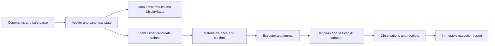

# Current application and execution architecture

The supported schema and move commands use one confirmed-plan executor. Rename
execution remains explicitly incomplete; this is not a claim that every slice of
the refactor has finished. The [stage records](execution-refactor-plan.md) explain
the implementation checkpoints and intentional changes.

## Module responsibilities

| Module | Responsibility |
| --- | --- |
| `command_list.py`, `command_card.py`, `page.py` | Authoring, selection, confirmation, recovery choice and rendering. The page reads immutable command results and report display snapshots. |
| `applier.py` | Headless command application, frozen iteration targets, variables, atomic draft publication and generation/cancellation guards. No endpoint writes. |
| `resource_state.py`, `multi_form.py` | Canonical resource payloads/revisions and successful baseline evidence; form selection by ResourceKey. No visit-based write schedule. |
| `application_results.py` | Authored/actual results, immutable historical context and detached display projections. |
| `planning.py` | Typed effects, groups, candidate actions, footprints, creator provenance and isolated persisted deletions. |
| `confirmed_plan.py` | Stable identity allocation and exact frozen request review; evaluation/source/session binding and single-use execution attempts. |
| `executor.py` | All-baseline preflight, immediate checks, no-op skips, attempt-before-write journal, outcome classification and verified reverse recovery. |
| `action_handlers.py` | Schema/deletion and owned-resource-property comparisons, request intents, compensation intents and capability gates. |
| `api.py`, `endpoint_evidence.py` | Generated endpoint encoding/decoding, structured reads/failures, immutable receipts and versions. |
| `schema_change.py` | Schema equivalence only; the old execution functions are removed. |
| `schema_identity.py`, `schema_names.py`, `schema_resolution.py` | Identity/formula protection, names/defaults, reference labels and cached Apply reads. |

## Invariants and supported behavior

Apply publishes state, variables, identities, effects and planning together after
successful transformation and required resolution. Failure retains preceding
published state; rejected candidates are separate diagnostic attachments.
Historical display context is pinned; inspecting a tab changes no application state.

Apply is command-first across forms. Compatible schema effects may accumulate as
form-first writes. This accepted batching limitation does not imply arbitrary
cross-form read/write consistency. Explicit prerequisites, endpoint/scope boundaries
and deletion boundaries constrain grouping; there is no general dependency graph.
Resource moves precede later schema edits and may batch compatible entries.

Identity materialization precedes confirmation and is retained for that attempt.
Formula literals and historical preview identities are preserved. Execution cannot
substitute variables, expand commands, allocate replacement identities or query
names/defaults. Reference-default cache keys use immutable scalar type tags so
resolved aliases survive confirmation with numeric/string distinctions intact.

Every required baseline is checked before any write; each action then checks its
immediate predecessor and explicit member prerequisites. The executor journals
before sending. It reads back on reported success and error, distinguishing
intended, unchanged, divergent and unknown state. Receipts alone prove none of these.
A reported error stops forward execution even when intended state is observed.

RollbackLast skips proven unchanged attempts. RollbackAll reverses applicable
actions. Unknown outcomes reconcile first; divergent outcomes do not establish
ownership, even if a later read matches the divergent state. Concurrent changes,
unknown preconditions or failed/unverified compensation stop recovery. Reported
recovery errors also stop, retaining read-back evidence. Forward and recovery
histories are separate immutable values; reports never fill unknown state with an
intended payload. Caches can be cleared without altering retained plans or reports.

Schema replacement compares the schema using its established defaults/equivalence.
Resource patches compare owned properties with strict presence/type semantics and
required existence/type, preserving unrelated concurrent properties. Missing form/
folder parents normalize specifically to the documented database-root identity.
Read-check-write still has a concurrency window; it is not a conditional write or
cross-endpoint transaction.

## Capability limits

| Capability | Status |
| --- | --- |
| Add/modify/move/delete fields, WithForm, SetVariable | Supported through Apply and confirmed execution where writes are required. |
| ModifyForm record label, including clear and pending field IDs | Supported. |
| MoveForm within its database, top-level forms | Supported with resource snapshots and owned-property compensation. |
| ModifyForm name | Local schema/resource preview supported; execution blocked. The [stage-6 evidence record](execution-refactor-stage6.md) explains the unverified label side effects and compensation order. |
| Persisted-field compensation | Schema-only; record-data restoration unverified. |
| Arbitrary resource property clearing, AddForm/DeleteForm, new recovery endpoints | Not enabled; separate feature/evidence work. |

No live recovery experiment or dependency upgrade was part of stages 0–7.

## Regression fixture construction

`test/execution_fixtures.py` translates low-level dict-service scenarios into typed
candidate plans, local pre-confirmation preparation and a mock observation/write
adapter. It delegates all execution/recovery to the production Executor; it contains
no competing journal, retry or compensation loop. Older fixture assertions now use
the actual report statuses, immediate-read behavior and conservative recovery rules.
`test/form_command_runtime.py` similarly adapts the preserved form-command mocks.
UI workflow tests use the real Applier, confirmation gate and Executor with mocked
services. These test construction helpers are not imported by application modules.
