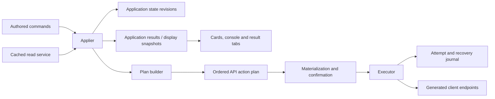

# Application state and API execution refactor

Status: reviewed design; stages 0-3 completed.
Prepared/revised: 2026-11-19. The user authorized stage 3; stages 4 onward and
live API writes remain outside the current authorization.
See [the staged implementation plan](execution-refactor-plan.md).
See [the stage 0 record and test inventory](execution-refactor-stage0.md) and
[the stage 1 implementation record](execution-refactor-stage1.md) and
[the stage 2 implementation record](execution-refactor-stage2.md) and
[the stage 3 implementation record](execution-refactor-stage3.md).

## 1. Objective and boundaries

Replace the schema-centered application/execution model with explicit resource
state, immutable application snapshots, an ordered API action plan, and a runtime
execution journal. Support form schema edits, database resource changes, and the
future creation/deletion of forms without disguising resource state as schema data.

Preserve the distinction:

- **Apply**: evaluate commands internally; cached API reads are permitted, writes
  are forbidden. Produce previews, diagnostics and a candidate execution plan.
- **Execute**: perform a confirmed, materialized plan through API endpoints.
- **Recover**: compensate attempted writes using observed preimages, with read-back
  verification and concurrency checks.

The refactor must preserve authored text, target matching, variable/function
behavior, command-first iteration, expanded application selection, annotations and
historical results. AddForm and DeleteForm are subsequent features; their state and
action contracts are specified now, but their complete creator syntax is not.

There is no claim of a transaction spanning API requests. A logical API action
normally has one forward write. Reads, verification and recovery may require
multiple calls. Endpoint atomicity must not be assumed beyond verified guarantees.

## 2. Current repository and migration baseline

- Latest commit inspected: `df131da`, multi-form iteration and expanded snapshots.
- Earlier commits: `0508630`, initial WithForm/multi-form execution;
  `d60644a`, SetVariable and iteration namespaces.
- ModifyForm and MoveForm work remains in the original working tree and is now
  preserved at `reference/pre-execution-refactor-20261119`, commit
  `d1e9e6863f9fbd0ff10d07eb802812e95a8444f8`. A separate hash-verified copy also
  retains original bytes and ignored HANDOVER.md. Do not reset, clean or stash it.
- Stage 0 verification: **393 current/reference tests pass** and **356 migration-base
  tests pass**, using the existing virtual environment and
  `.venv/Scripts/python.exe -m unittest discover -s test -t . -q`.
  APIs are mocked; live write/recovery behavior has not been established.
- `HANDOVER.md` is gitignored. This specification is a normal repository document
  and must be included in any eventual handover/checkpoint commit.

Established migration starting point: `refactor/execution-state`, based on `df131da`,
in the separate sibling worktree `activity-info-automanager-refactor`. The original
worktree remains on `master` with its work and index retained. The refactor branch
carries the design/plan/stage-0 documents, without porting architecture code yet.
Do not go back before multi-form iteration: its UI, parser, namespaces and
characterization tests remain valuable. The 37 form-command tests absent from the
older baseline remain required stage-6 porting work, not waived regressions.

Current replacement targets:

| Current component | Replacement responsibility |
| --- | --- |
| `CommandListManager` application loops | Applier, with UI manager retaining list/selection concerns |
| `FormWorkspace.opschema` and parallel folder arrays | Versioned application resource state and ordered action groups |
| `CommandExecution` schema-centric snapshots | Authored results and concrete application results with DisplayState |
| `prepare_operations` | Explicit plan compilation/materialization |
| `apply_schema_sequence` | Generic action executor and execution journal |
| `form_move_execution.py` schema-metadata adapter | Retire after resource action migration |

Reuse the catalogs, safe parser, creator controls, field transformation logic,
template/function machinery, identity allocation/remapping, schema comparison,
resolution caches, annotation rendering and appropriate tests. Keep generated
client access behind the API adapter. No replacement UI framework is needed.

## 3. Components and ownership

- **Applier** owns evaluation order, expansion, substitutions, variable scopes,
  target snapshots and the current application state.
- **Commands** produce staged state changes, diagnostics and typed effects. They
  do not mutate the Executor, journal, published snapshots or live API.
- **PlanBuilder** owns action selection, compatibility, explicit action prerequisites,
  coalescing, provenance and ordered groups. General cross-form dependency analysis
  is deferred as described in section 9. Commands never receive an arbitrary mutable
  `curApiAction` reference.
- **Executor** consumes a frozen confirmed plan. It cannot expand commands or
  reinterpret their parameters during execution.
- **Action handlers** own endpoint-specific reads, payload encoding, comparisons,
  verification and recovery strategies.
- **ExecutionJournal** owns observed outcomes. It is separate from the candidate
  plan and from preview state.

These are responsibility boundaries; Python classes/modules should follow them
without requiring one class per line of this specification.

## 4. Resource and state contracts

### ResourceKey

Frozen, typed identity: `(kind, identity)`. Initial kinds:

- `FORM_SCHEMA`, identified by stable form identity.
- `DATABASE_RESOURCES`, identified by database ID.

Use keys rather than array positions as durable references. Maintain separate
ordered key lists for first-encounter/tab order. Database resource members are
identified by `(database_id, resource_id)` because folder IDs are database-scoped.

New forms/fields use stable preview identities before real ID allocation. Remapping
must preserve all references, provenance and snapshot associations.

### ResourceState

Each state has a key, a typed payload, a local revision, load status and provenance.
Load status distinguishes unloaded/loaded/unavailable. Form lifecycle distinguishes
existing/new/deleted, with verified absence represented explicitly in baselines.
An unavailable read is never interpreted as absence.

- Form payload: canonical schema data, using IDs for stored references.
- Database-resources payload: resource entries keyed by resource ID, plus explicit
  ordering for display and any server version receipt. Persisted entries retain
  unrelated properties. Future deleted entries retain tombstones/preimages locally.

Use immutable values or defensive copy-on-write. A frozen dataclass containing a
mutable shared dictionary is insufficient. API model objects may be constructed at
the adapter boundary; working state must not be a mutable SDK request object.

### BaselineStore

Stores successful remote reads and their existence/version evidence for this
evaluation. Remote state is loaded once as needed and cached. A later action on a
known resource starts from its projected local predecessor, not a fresh copy of
the original server schema. Optional suggestion reads do not establish a write or
append an action group.

### ApplicationState

Contains resource states/revisions, active database/form context, any active
multi-form scope, global/per-target variables, reserved identities and diagnostics
associated with resource snapshots. Current local states override cached remote
states in name resolution and cross-form reads.

Form schema labels and database resource labels represent one logical form name.
Renaming updates both loaded projections coherently; an unloaded projection is
reconciled with the local name when loaded. The successfully staged schema label
is authoritative for local name resolution in this evaluation; remote directory
reads must not restore an older name.

The rename handler declares the expected schema label and corresponding database
resource label. Before enabling renamed-form execution, establish whether the schema
endpoint updates both from installed-client/official endpoint evidence. Do not infer
this from local projections or mocks. If it does, use one schema write and verify
both labels, preserving unrelated resource properties. If it does not, define an
explicit additional resource-label action, its order and compensation before enabling
that path; never silently add a second write. If the contract remains unresolved,
block execution of plans containing renames with a clear reason. Record-label-only
edits do not depend on resolving this rename contract.

### ReadSet / WriteSet

An effect identifies the resource keys, member IDs, paths and lifecycle facts it
reads or writes. A schema update that replaces the complete schema has a whole-
schema write footprint. A MoveForm resource patch writes the selected resource's
parentId, not every entry in its database.

A form's presence in a database resource list, a folder's existence, and a pending
form's creator action are dependencies even when no property value changes.
Initially these footprints support explicit action prerequisites, stale checks,
verification and recovery ownership. They do not require a dependency graph of
arbitrary command-time reads or a cross-form batching consistency analyzer.
Display-only reads do not create write prerequisites; lookup variable values remain
captured application-time results and are not re-queried by the Executor.

## 5. Authored commands, actual applications and results

### AuthoredCommand

Stable authored ID, order, validated command definition/parameters, and original
unsubstituted syntax/source information. Keep the existing AST-based syntax and
serialization; do not introduce string-based evaluation. Text/list views contain
one entry per authored command.

### ActualCommand

Stable application ID, authored ID/index, position within the authored result,
concrete validated parameters after single-pass substitution, logical target
identities, and a context path such as `(database, form, field)` where available.
The logical target can differ from the API write owner: MoveForm targets a form
but writes its database-resource entry.

### ApplicationResult

ActualCommand, status, diagnostics/messages, concrete targets, referenced effect/
action IDs, and the immutable post-application DisplayState. Failed applications
retain the preceding successful state and record diagnostics. Unexecuted planned
applications have target/context metadata but no invented post-state.

When resolution fails after a transformation, retain the rejected candidate and
candidate-relative diagnostic paths as a separate immutable diagnostic attachment.
It is never published as canonical state, used by later commands, or included in
the execution plan. Error inspection may show it clearly labelled as a rejected
candidate; candidate paths must not annotate the preceding successful DisplayState.
This tightens current behavior, which can publish transformed schemas on resolution
errors. Transformation and resolution failures have the same atomicity guarantee.

### AuthoredCommandResult

Authored command, ordered flat actual results, aggregate diagnostics/status and a
final DisplayState. Store this separately even when there are zero actual results.
It owns zero-match/selector warnings and the unchanged preceding snapshot.

### DisplayState / DisplayResource

A complete ordered set of display resources, affected resource keys, payload
revisions, resource annotations and preferred selected tab. Initial display types:

- Form schema tab: form resource key and immutable schema payload.
- Database resources tab: database resource key and immutable resource-entry array.

DisplayState is a view of canonical state, not the input from which commands
reconstruct resource state. Store structured payloads, not rendered JSON strings.
Names/IDs rendering and record-label enrichment operate on the selected snapshot.
Display resources refer to stable keys/revisions, never mutable API action payloads.

Each DisplayState also retains the related schema revisions, name mappings and
annotation context needed to render that snapshot, including read-only related
resources that have no tab. Rendering historical results must not consult later
mutable application caches. Record labels available at capture are pinned. Missing
historical labels retain their ID fallback rather than triggering a live refresh.
Async enrichment of the current result may publish a new immutable display revision
after generation/context checks; it must not mutate earlier snapshots, pinned labels,
canonical state, plans or confirmation. No record-label snapshot implies a historical
snapshot of the server's record data.

Each loaded affected form has one tab; each affected database-resource collection
has one tab, reused on revisits. Read-only related forms/folders loaded exclusively
for resolution/suggestions do not automatically acquire tabs. AddForm affects both
its form and database-resource tabs. MoveForm changes the database-resource tab;
its target form is also available and becomes the active context. Prefer the
changed database tab for MoveForm/AddForm/DeleteForm and the changed form tab for
schema edits. Tab selection does not change command application context.

Deletion removes an entry from the database-resource display and leaves an
explicit deleted-form tab/tombstone with its last schema and lifecycle indicator.
Historical snapshots continue to show the form as it existed at that point.

## 6. Application algorithm and atomicity

1. Start a fresh evaluation with empty variables, the initial selected context and
   baseline/local resource state. Assign an evaluation generation token.
2. Visit authored commands sequentially. Resolve their selectors against current
   state; expand only the command/scope now being reached. Never expand the entire
   document before applying earlier commands.
3. Freeze multi-form targets at scope entry; freeze field targets for every scoped
   form at the incoming state of each repeated field command. Preserve ID bindings,
   original names/codes, captures and indices. This keeps complete planned counts
   after an early failure.
4. Prepare each actual command once. Substitute only allowed namespaces; validate
   the reconstructed concrete command. Preserve `$${` escaping and prevent a
   second substitution pass at execution or in a handler.
5. Apply into a private candidate state and stage typed effects. Resolve required
   references. Ask PlanBuilder to stage compatible plan changes.
6. Publish state, plan changes, variable changes and result snapshot together only
   if application succeeds. On failure, discard all staged changes for that actual
   command. Read-cache enrichment may survive; partial logical edits may not.
7. Warnings may continue. Errors stop subsequent actual and authored commands.
   Preserve reached snapshots and all known unexecuted target metadata.

Read-only/context-only commands can produce actual results without API actions.
SetVariable and WithForm must never generate no-op writes merely to support cards.
Late async results must check generation/context before publishing state or plans.

## 7. Iteration, variables and presentation invariants

- Form patterns full-match names in the active database, ordered by
  `(name.casefold(), form_id)`. Single targeting retains name/ID/Database/Form rules.
- Form context supplies original `form.name`, one-based `form.index`, and named/
  numbered captures. Name/index are reserved capture names. Keep field namespaces,
  reserved capture names and variable syntax as currently documented.
- Commands inside a form scope apply A1, B1, A2, B2. Field applications flatten in
  execution order: A4i, A4ii, B4i, B4ii, B4iii.
- WithForm, ModifyForm, MoveForm and future AddForm establish/replace form context;
  a new form-switching command is evaluated once at authored level. DeleteForm does
  not switch to its targets. Future WithDatabase is outside initial scope.
- Globals are independently inherited by each scope member. Assignments inside the
  scope are local. On scope exit, remove assigned names from the outer mapping,
  including inherited names reassigned inside. Untouched globals survive.
- Empty scopes warn and skip following applications until the next context switch.
- A card counter counts concrete planned applications, including unexecuted ones.
  Zero field matches contribute no child but retain a parent warning. Cards expand
  upward; children show complete context paths and independent statuses.
- Selecting a parent shows its final reached DisplayState and aggregate messages;
  selecting a child shows that exact post-state and its messages. Collapsing a
  selected child selects the parent. No UI action changes authored text cardinality.

## 8. API action and execution plan contracts

### ApiAction

Frozen action ID, handler kind, logical subject, affected/read/write resource sets,
action-group ID, contributing application IDs, dependency IDs, expected starting
state, projected ending state, creation/deletion provenance and recovery capability.
Keep typed endpoint-specific intent/payload templates and comparison rules.

Each action explicitly defines forward verification and recovery verification;
these can cover more resources than the primary write target. Verification
expectations are derived from the intended post-state, not simply copied from an
SDK request with different response shape.

### ExecutionPlan

Ordered actions plus baselines, resource identities, dependencies, required reads,
materialization map, warnings and recovery capability summaries. Application order
and API action order are distinct and both inspectable. Confirm actual action
order and effects, including deletion and compound recovery requirements.

The candidate plan may be refined by PlanBuilder during application. After ID
materialization and confirmation it is immutable. A changed command list or source
invalidates confirmation. Runtime reads do not silently change intended payloads.

### Initial handler kinds

| Handler | Forward write | Verification | Recovery intent |
| --- | --- | --- | --- |
| FormSchemaUpdate | update_form_schema | Relevant complete schema, plus declared resource side effects | Restore immediate schema preimage |
| DatabaseResourcePatch | update_database.resourceUpdates | Patched entries/properties and required existence | Patch immediate prior values only |
| PersistedFieldDelete | update_form_schema | Schema missing identified persisted field | Field recovery strategy plus exact preimage restoration as necessary |
| FormCreate | add_form(AddFormRequest) | Form existence/schema AND database resource attributes | Conditionally delete the form created by this action |
| FormDelete | update_database.resourceDeletions | Resource deletion and form lifecycle | Verified restoration strategy when available; never substitute empty recreation |

These handler kinds need not be a subclass hierarchy with duplicated orchestration.
A shared protocol plus endpoint-specific implementations is sufficient. SDK calls
stay in the session API adapter, allowing mocked handlers and generated endpoints.

Minimum handler protocol (names may be adjusted idiomatically during implementation):

| Method | Contract |
| --- | --- |
| read_state(intent) | Return typed observations, existence evidence, versions and read failures for the required footprint |
| compare(expected, observed, footprint) | Return structured matches/differences; do not hide unknown state |
| encode_write(intent, identity_map) | Produce the generated client's request arguments/model without changing intent |
| write(request) | Return a receipt or structured transport/API error; neither alone establishes applied state |
| classify_outcome(before, intended, observed, receipt) | Classify applied, unchanged, different observed state, or unknown |
| build_recovery(journal_entry, current_observation) | Validate ownership/concurrency/capability and return an ordered compensation recipe or a blocking reason |
| recover_step(step) | Perform one compensation request, retaining receipt/error |
| verify_recovery(entry, observation) | Check the promised restored dimensions against the immediate preimage |

The adapter must preserve distinctions between not-found/deleted, permission denied,
invalid response and transport failure. The current generic ValueError-based read
surface may require structured error/result types, especially for creation absence
checks. Handler initialization must not overwrite projected state with remote data.
The adapter must also retain available write receipts, schema/database versions and
structured error details instead of discarding them. An absent receipt/version stays
explicitly absent; neither receipt presence nor HTTP success proves application.

## 9. Action groups and action reuse rules

Do not implement reuse as 'last action' or 'last matching resource' alone. Use an
explicit group/epoch and a candidate map keyed by resource and action capability.
Backward lookup can be an implementation detail, not the eligibility definition.

Application remains command-first: A1, B1, A2, B2. Within a compatible schema group,
execution remains form-first: accumulated A, then accumulated B, in first-write
encounter order. Do not add general read/write dependency analysis, dependency-
induced splitting or a consistency guard for arbitrary cross-form reads during the
initial migration. The user accepts the rare inconsistencies this batching can
introduce between command-time observations and intermediate server states. They
are a documented limitation, not an initial acceptance failure. Do not promise that
all application-time cross-form observations are reproduced during execution.

Explicit endpoint/resource-operation boundaries still preserve command-effect order:
seal open schema candidates before a resource patch, and seal resource patches
before subsequent schema effects. Compatible adjacent resource patches may batch;
do not move them across schema effects. Ending/replacing a scope seals its candidates.
A same-form WithForm outside a scope remains a no-op and need not create a write
boundary; ending an existing multi-form scope always closes that group. Ordinary
single-form revisits retain order. No global regrouping by form or endpoint is allowed.

Intentional change from the folder adapter: MoveForm(B), then AddField on B executes
the move before the schema update. The current adapter does the reverse. Accordingly,
RollbackLast after a later changed schema attempt restores that schema attempt and
leaves the earlier move in place. MoveForm across A/B followed by field edits executes
the resource patch(es) before accumulated A/B schema writes, rather than interleaving
schema-before-move visits. Confirmation must show the resulting actual action order.

An effect can extend an action only when **all** conditions hold:

1. The action is open in the eligible group and targets compatible resource keys.
2. Its handler supports the effect and the resulting recovery guarantee.
3. The candidate's projected state is a valid predecessor for the effect.
4. No declared creator/lifecycle prerequisite would be placed after its use.
5. No deletion, recovery boundary, endpoint/resource-operation boundary or explicit group
   boundary requires a new action.
6. Contributions/provenance and before/after expectations can be updated atomically
   without mutating published snapshots.

These are local compatibility and boundary rules, not a requirement to discover
hidden dependencies between arbitrary A/B applications. Retain creator-action and
action-start membership tracking for identity/deletion correctness. No new general
referential-integrity checks are added to DeleteField. Future lifecycle features
must establish their explicit prerequisites when implemented; optional create/delete
elimination may simply be omitted when safety cannot be established locally.

| Incoming effect | Allowed extension |
| --- | --- |
| Add/modify/move field; schema setting edit | Compatible open FormSchemaUpdate, or the same open FormCreate |
| Delete field created within that exact action | Same update/create action, subject to existing command validation and explicit local prerequisites |
| Delete previously persisted/planned-earlier field | New PersistedFieldDelete; initially isolate one persisted field per action |
| Modify schema after PersistedFieldDelete | New FormSchemaUpdate with predecessor equal to deletion result |
| Patch resource parent/name/etc. | Compatible open resource patch, limited to its entries/properties and dependencies |
| Change newly created form | Open FormCreate only where group/boundary and explicit prerequisite rules allow it; otherwise a later action |
| Delete a new form before any required external use | May eliminate its creation and dependent local-only effects after proving no surviving dependencies |
| Delete an existing form | Separate FormDelete boundary |

Do not use 'has temporary ID' as evidence of creation within the current action.
Example: AddField(x) in action 1, MoveForm in action 2, AddField(y) in action 3,
then DeleteField(x). Field x is still temporary in preview but will exist remotely
before action 3. Track creator action and action-start membership explicitly.

Several compatible moves may share one resource update request. Their card count
still counts actual commands, while the journal counts the resulting API request.
RollbackLast then refers to that request's complete set of affected entries.

Examples to lock down before migration:

- WithForm(A/B), AddField(x), ModifyField(x): two accumulated schema actions, A then B.
- MoveForm(A/B), AddField(x): compatible resource patch(es), then schema A, schema B.
- AddField(x), MoveForm(current), AddField(y), DeleteField(x): schema creation of x,
  resource move, schema creation of y, persisted deletion of x. The last deletion
  uses action-start membership even though x has a preview identity during Apply.
- AddField(x), DeleteField(x) within the same eligible schema action may collapse
  to no write. Deleting an action-start field always establishes its own boundary.

## 10. Command-specific effects

- **WithForm**: load/select current local schema; establish context/scope; no write.
- **SetVariable**: change application variable state; no write. Lookup reads remain
  online record queries during application, following existing semantics. Execution
  uses the captured result and never re-queries to reinterpret the command.
- **MoveField/ModifyField/AddField**: stage atomic schema transformations, then use
  the reuse rules. Preserve current matching, mismatch warnings, option identities
  and function behavior.
- **DeleteField**: eliminate a field created in the same action when safe; otherwise
  use a persisted deletion action. Identify recovery by field ID and saved state,
  not only by the endpoint payload. Subsequent unrelated edits cannot be absorbed
  into a deletion action merely because they share a form.
  Persisted deletions are separate actions even when surrounding edits could have
  been sent as one legacy schema replacement. This intentionally increases request
  counts and exposes additional intermediate server states and rollback units.
- **ModifyForm**: stage optional schema label/recordLabelFieldId changes and coherent
  local resource-name projection; select targets as active context. Keep optional
  inclusion checkboxes, blank-name rejection, blank-record-label clearing and
  ID-first/code matching. Newly added record-label fields remap during materialization.
- **MoveForm**: stage a database resource parent patch; select the target form(s).
  Resolve folder IDs, unique names, absolute/relative paths, `/` root within the
  target database. Single remote targets use their database; multiple targets use
  the active database. No cross-database transfer or independent subform move.
- **AddForm (later)**: create a new form identity/state plus database-resource entry,
  create FormCreate intent with formResource and formClass, and activate the new
  form. Field edits can extend that creation only under the reuse rules.
- **DeleteForm (later)**: remove the resource entry from live application state and
  mark the form deleted, preserving tombstones/history. Do not activate targets.
  Deleting the current active form leaves the database selected and no active
  single form; later form-dependent commands fail until context is selected again.
  In a surviving multi-form scope, deleted members are no longer eligible for
  subsequent applications. Never silently switch to an arbitrary surviving form.

Loads of schemas, folders and dropdown suggestions never write, create action
groups, or replace current local edits. Retain generation checks for async reads.

## 11. Materialization, confirmation and preflight

After successful application, allocate stable real IDs once for all pending forms,
fields/options/lookups. Remap schemas, resource entries, references, record labels,
formula identifiers, action dependencies and endpoint templates consistently.
Preserve existing protections for deleted/re-added fields and literal formula text.
Retain the mapping for the whole execution/recovery run; retries cannot create new
identities. Historical preview snapshots keep their original identities.

ID allocation is local preparation, not an API write or a reservation on the
server. This specification chooses materialization before confirmation so the
reviewed plan can name exact targets; the same allocation must be used when that
plan executes. Cancelled or invalidated plans cannot later be executed.

Confirmation presents the materialized ordered action list, targets, destinations,
deletions, contributing commands, and supported recovery guarantees. No endpoint
write occurs before confirmation. Cancel discards that execution attempt only.

Preflight reads all required baselines before the first write: existing schemas,
affected resource entries, destination existence, and absence of allocated new
form IDs. A 403, network failure or unavailable lookup does not establish absence.
Do not compare unrelated database entries to reject harmless concurrent changes.
Honor existing schema equivalence rules where appropriate; resource comparisons
require explicit missing/null/existence rules rather than schema-specific defaults.

Immediately before each write, reread and compare against the expected predecessor,
which includes verified results of earlier actions. Revalidate destinations and
other lifecycle dependencies. No-op actions are recorded as skipped, not journaled
as successful writes. Preflight/stale failure before any write needs no rollback.

## 12. Runtime execution and journal contracts

### ExecutionAttempt / JournalEntry

Action ID/order, materialized request, attempt state, fresh observed preimage,
observed postimage, verification diagnostics, returned versions/receipts, timestamps
and recovery attempts. Candidate-plan baselines are not runtime journal entries.

Attempt states distinguish not_started, skipped, attempted, verified_applied,
verified_unchanged, failed_with_observed_state, and unknown_outcome. Recovery has
separate attempted/verified/failed/unknown statuses; never overwrite forward history.

For each action:

1. Read/check immediate preconditions; capture a defensive preimage.
2. Append attempted journal entry **before** sending the write.
3. Send through the action handler; retain response/exception/receipt.
4. Read back on both success and reported failure. Classify whether intended state,
   prior state or another observed state exists. A lost response can follow a
   committed write. An HTTP success alone is not verification.
   If observed state matches neither preimage nor intended state within the owned
   footprint, classify it as divergent, not as a safely recoverable owned change.
5. Continue only after successful write and verified intended post-state. Preserve
   current behavior of stopping for a reported write error even if read-back shows
   the intended change, offering recovery against that known state.
6. Otherwise stop forward execution and enter the recovery decision flow. Do not
   automatically retry create/delete/recovery after an uncertain response.

Return structured actual resource states, diagnostics and operation outcomes,
including unknown states. Reports must not substitute intended state for unreadable
actual state. Invalidate stale read caches after the attempt; keep reports stable.

## 13. Recovery policy and verification

Offer Leave, RollbackLast and RollbackAll once after forward execution stops.

- Leave performs no compensating writes and accurately reports partial/unknown state.
- RollbackLast selects the latest attempted action with a known change or unresolved
  possible change. Skip actions proven unchanged. If the failed action is proven
  unchanged, the previous changed action is the last rollback candidate. This is an
  explicit refinement of the current attempt-based behavior.
- RollbackAll traverses applicable journal entries in reverse action order.
- Before each recovery, reread and compare the action's affected state with its
  observed postimage. Stop when concurrent changes make recovery unsafe. Compare
  the whole schema for full replacement; compare only owned properties for patches.
- If outcome remains unknown, reconcile with reads first. An inability to establish
  the recovery precondition blocks recovery; do not blindly restore or skip past it.
- A divergent observation is evidence of actual state, not evidence that this action
  owns all differences. A later reread matching that observation does not establish
  ownership. Compensation requires an intended-poststate match or an endpoint-specific
  safe partial-outcome rule backed by evidence. Initially, divergent schema outcomes
  and divergent owned patch properties block automatic recovery. Differences outside
  patch-owned properties remain outside its compensation footprint. Blocked entries
  must not be skipped to recover earlier actions in RollbackAll or RollbackLast.
- Execute the handler's inverse or compensation sequence against the immediate
  observed preimage. Verify the recovered state after each required step and before
  continuing to the preceding journal entry. A recovery HTTP success is insufficient.
- A reported recovery error also requires read-back. Record whether state was
  restored, unchanged or unknown, and stop automatic recovery for investigation.
- Stop on any failed/unsafe/unverifiable recovery. Never claim rollback-all success
  when any action, resource or promised recovery dimension remains unrestored.

Resource patches restore only properties owned by the action. Restore a prior
absent property according to the endpoint's supported clearing semantics; sending
an omitted property must not be assumed to clear it.

Creation recovery may delete only the form owned by that creation action, after
checking it has acquired no external schema/resource changes, records or surviving
dependencies. If those checks cannot establish safety, recovery must stop. Preserve
allocated identity and execution evidence after a partial attempt; do not assume
the ID can be reused after deletion.

Without supported conditional writes, read-check-write has an unavoidable
concurrency window. Document it; do not present optimistic checks as server-side
atomic compare-and-swap or as a cross-endpoint transaction.

## 14. Recovery capabilities and unresolved API contracts

Represent capabilities explicitly: verified metadata restoration; verified data
restoration where established; conditional compensation; unsupported/unverified.
Do not infer record-data restoration from schema equality.

PersistedFieldDelete must retain field identity, pre-deletion schema, provenance,
and sufficient recovery parameters/receipts. A recovery recipe can require the
per-field recovery endpoint followed by exact schema-preimage restoration and reads.
One deletion action initially isolates one persisted field; batching several
deletions needs an explicitly tested multi-step recovery recipe.

The user has since confirmed that rollback restores deleted fields and deleted
forms with their data. Field rollback restores the immediate schema preimage;
form rollback reverts the attributed database deletion event using its receipt
version. Keep original identities and receipts; recreating an empty form schema
is not the form recovery strategy. Confirmation and reports no longer show the
former data-restoration limitation. Automated recovery checks remain schema and
resource read-back; user testing supplies the record-data restoration evidence.
No new recovery endpoint or dependency change is needed for this update.

## 15. Endpoint mapping and evidence

Verified against installed activity-info-python-client 2.0.4 and official reference
pages during this discussion (2026-11-19). The web reference can be broader than
the installed generated client. Recheck relevant contracts when implementing.

| Intent | Endpoint | Request shape |
| --- | --- | --- |
| Read schema | GET /form/{formId}/schema | none |
| Update schema | POST /form/{formId}/schema | FormSchema |
| Read resources | GET /databases/{databaseId} | none |
| Patch/move resource | POST /databases/{databaseId} | UpdateDatabaseRequest.resourceUpdates |
| Create form | POST /databases/{databaseId}/forms | AddFormRequest: formResource + formClass |
| Delete form resource | POST /databases/{databaseId} | UpdateDatabaseRequest.resourceDeletions |
| Recover persisted field, candidate | POST /form/{formId}/field/{fieldId}/recover | identity in path |
| Revert database update, candidate | POST /databases/{databaseId}/versions/{version}/revert | identity/version in path |

References:

- [Update database](https://www.activityinfo.org/support/docs/api/reference/updateDatabase.html): resource patches/deletions; subform deletion uses the parent schema instead.
- [Add form](https://www.activityinfo.org/support/docs/api/reference/addForm.html): combined formResource/formClass creation request.
- [Update schema](https://www.activityinfo.org/support/docs/api/reference/updateFormSchema.html).
- [Recover form field](https://www.activityinfo.org/support/docs/api/reference/recoverFormField.html): recovers from the latest schema version containing the field; subform recovery explicitly unsupported. Exact state/data restoration requires validation.
- [Revert database update](https://www.activityinfo.org/support/docs/api/reference/revertDatabaseUpdate.html): version-addressed revert exists; user testing has confirmed form and record-data restoration.

## 16. Implementation sequence and acceptance criteria

Stages 0-3 are complete; stages 4 onward await an explicit implementation instruction. The companion
[staged implementation plan](execution-refactor-plan.md) defines deliverables,
checks, completion criteria and cutover boundaries:

0. Preserve the current work and establish the `df131da` refactor baseline.
1. Add canonical resource/result contracts and self-contained display snapshots.
2. Extract the Applier and make application/resolution failures atomic.
3. Add PlanBuilder, simple grouping, provenance and persisted deletion boundaries.
4. Add endpoint handlers, structured observations/receipts, materialization and
   confirmation of the actual frozen plan.
5. Add the generic Executor, runtime journal and verified recovery; cut over schema
   execution only when its complete safety path passes.
6. Port ModifyForm/MoveForm, coherent names and database-resource tabs; verify mixed
   execution and remove the folder/schema adapter.
7. Complete integrated browser/mocked checks and retire obsolete orchestration.

AddForm/creation compensation and later recovery investigation/DeleteForm are
separate feature stages after the initial migration, requiring their own explicit
implementation instruction. No cross-form dependency analyzer is an initial stage.

Required tests cover:

- Existing parser/catalog/creator behavior, field edits, substitutions/functions,
  ID/name resolution, pending identities and annotation/history preservation.
- Exact form and field application order, frozen targets, complete unexecuted
  counts, zero matches, local variables and stale async cancellation.
- No API writes during application/suggestions; failed applications change neither
  published state nor plans; context-only commands produce no writes.
- Snapshot immutability when an open action is later extended; parent/child/tab
  selection across both resource types and deleted/new resource display states.
- Compatible A/B reuse with command-first application/form-first schema execution,
  explicit group/endpoint/deletion boundaries, database entry patch batching and
  no global endpoint-based reordering. Cross-form dependency-induced splitting is
  deferred; the accepted ordering limitation is not a failing migration criterion.
- Move-before-schema mixed execution, including exact forward/compensation order
  and RollbackLast when the later failed action is changed versus proven unchanged.
- Resolution failures preserve state/plan/variables and keep rejected-candidate
  diagnostic paths separate. Historical rendering retains related context and
  pinned record labels without consulting later caches.
- The temporary-field counterexample in section 9, persisted deletion boundaries,
  and later edits starting from the deletion result.
- Stable materialized IDs across references/actions, including record labels, with
  preview identities retained in historical snapshots.
- Per-action exact payloads via generated client mocks; unrelated resource
  properties preserved; no synthetic schema metadata sent to any endpoint.
- Preflight before all writes, immediate stale checks, no-op skipping, external
  schema/resource edits, missing destinations and unknown/permission-denied reads.
- Timeout before/after commit, success with wrong state, failed write with committed
  state, partial/unknown observations, divergent outcomes blocking unsafe recovery
  and no blind non-idempotent retries.
- Immediate preimages for revisits, reverse mixed-endpoint rollback, RollbackLast
  after an unchanged failure, verification after every recovery, concurrency guards,
  unsupported recovery and stopping at the first unsafe/failed recovery.
- Confirmation uses the actual ordered plan; invalidated confirmation cannot run;
  final reports retain observed/unknown state after cache resets and reevaluation.
- Rename handler evidence and verification cover both label projections; unrelated
  database properties survive. Unresolved rename contracts block rename execution.
  Available receipts/versions and structured failure details survive in the journal.

Later AddForm/DeleteForm milestones additionally require create-plus-fields plans,
multi-resource creation verification, explicit creator-before-use prerequisites,
and safe creation compensation. Optional create/delete elimination requires proof
that no surviving dependencies remain; omit the optimization otherwise. Those tests
are not prerequisites for completing the initial migration.

Do not replace meaningful existing tests with tests that merely mirror new classes.
Endpoint mocks do not establish live record recovery. No live writes or recovery
experiments are authorized by this document.

## 17. Instructions for the next chat

Read this document, the staged implementation plan, stage 0 record and HANDOVER.md
first. The user authorized stage 3, which is complete; read its implementation record. Treat this specification as
the reviewed target and the preserved current code as the reference, subject to the
intentional behavior changes below. Await instruction for stage 4; use the existing
refactor worktree rather than recreating branches or resetting the original work.

Preserve current uncommitted ModifyForm/MoveForm work before any branch operation.
Discuss any departure from the state, batching or recovery contracts explicitly.
Keep AddForm/DeleteForm implementation and unverified recovery endpoints outside
the initial migration. Continue using the project's virtual environment for checks.

Reviewed resolutions: retain command-first application and form-first multi-form
schema batching, accepting rare cross-form inconsistencies without general dependency
guards; respect explicit schema/resource/deletion boundaries; move before subsequent
schema edits; make resolution failures atomic with separate rejected-candidate
diagnostics; isolate persisted field deletions with retained identities and preimages;
verify coherent rename projections; block unsafe divergent-outcome recovery; retain
snapshot-specific rendering context and pinned historical record labels. Use a
preserved current checkpoint as reference and `df131da` as the migration base.

Other retained defaults: database-resource tabs for resource mutations; no active
form after deleting the current single target; RollbackLast skips attempts proven
unchanged; materialization precedes confirmation. These are target choices, not
claims about implemented behavior. Rename endpoint side effects remain an evidence
gate in stage 6; no unverified behavior is asserted by this documentation update.

Suggested opening message for the next chat:

> Read HANDOVER.md, docs/execution-refactor-spec.md and docs/execution-refactor-plan.md.
> The reviewed design accepts the multi-form batching limitation; do not add a general
> cross-form dependency analyzer. Stages 0-3 are complete, including atomic candidate
> planning with groups, creator provenance and persisted field deletion boundaries.
> Execution still uses legacy visits. Read the stage 3 record and continue with stage 4
> only when instructed.
